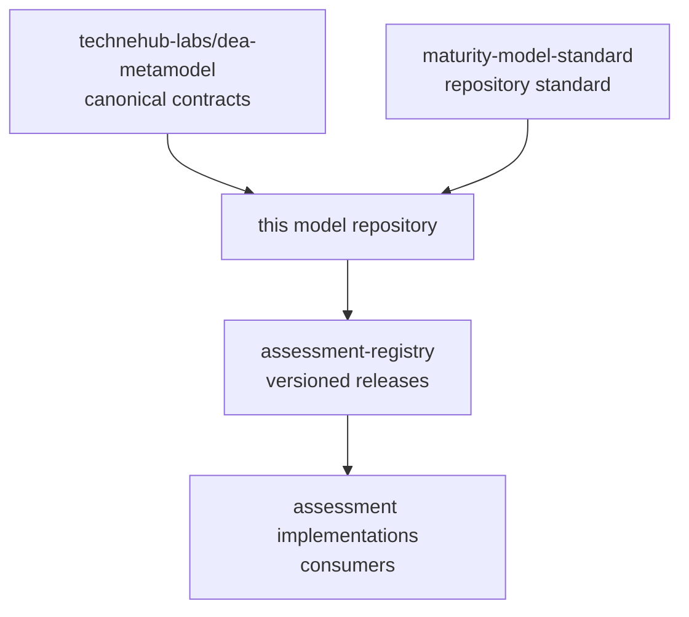

# DGM-01 — Model positioning (TEMPLATE)

Purpose: shows this model's position in the Assessment-Models ecosystem and its relationship to downstream consumers.

TODO: replace with the model's real positioning diagram. Keep labels consistent with the machine-readable model; do not duplicate normative definitions in labels.
