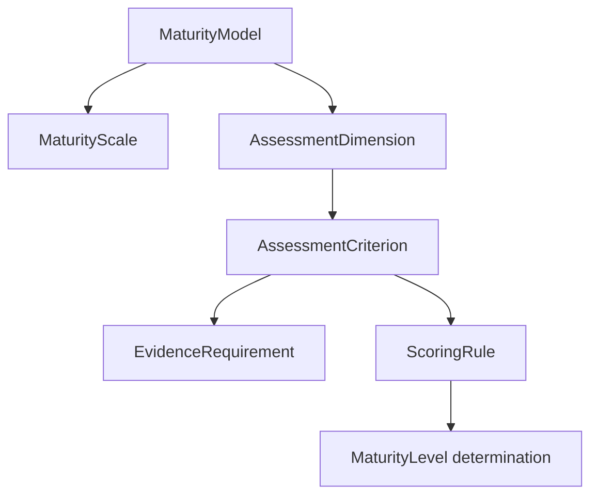

# DGM-02 — Conceptual architecture (TEMPLATE)

Purpose: explains the major concepts and relationships constituting the model.

TODO: replace with the model's real conceptual diagram, keeping canonical boundaries (MaturityModel vs AssessmentModel vs AssessmentExecution vs AssessmentResult) distinct.
