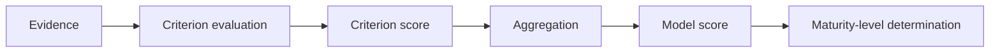

# DGM-03 — Assessment architecture (TEMPLATE)

Purpose: explains the relationship between dimensions, criteria, evidence, scores and maturity determination.

TODO: replace with the model's real assessment architecture; it must agree with the `scoring` block of the authoritative model definition.
