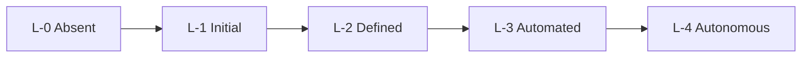

# DGM-04 — Maturity progression (TEMPLATE)

Purpose: visually explains the bound scale's maturity levels and progression semantics.

TODO: replace with the model's real progression diagram, generated from or validated against `maturity/scale.yaml`. Model-specific stage names are additive metadata, never a second ladder.
