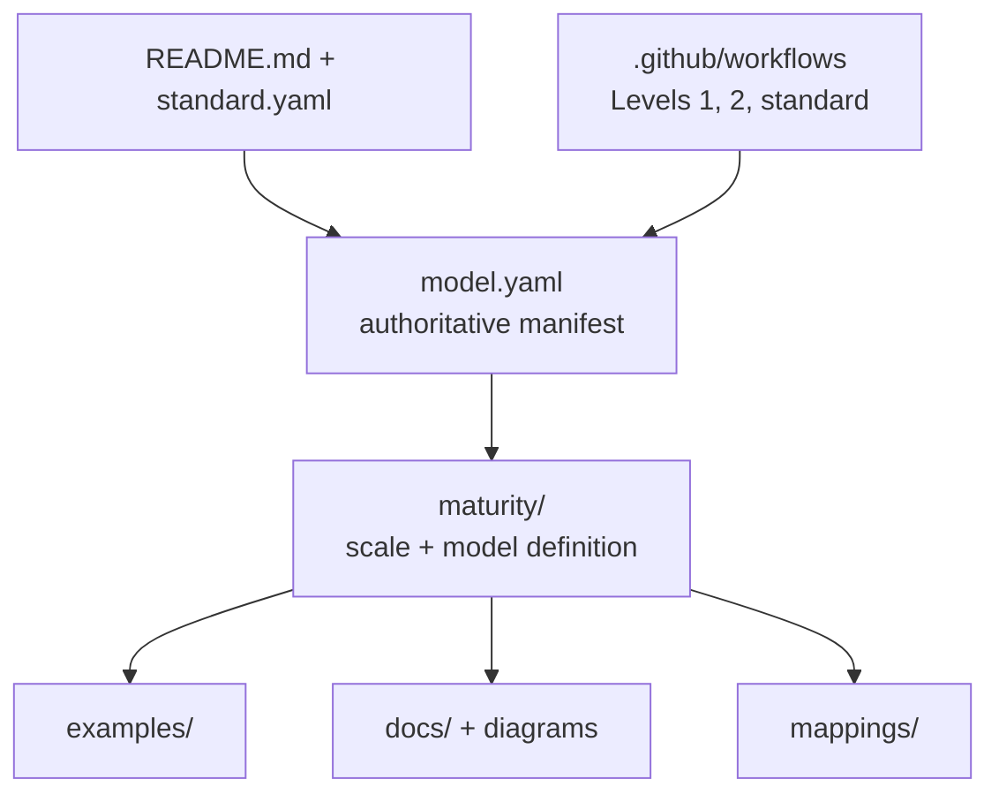

# DGM-06 — Repository architecture (TEMPLATE, recommended)

Purpose: explains the repository's files, directories and their relationships.

TODO: adapt to the repository's real structure once established.
